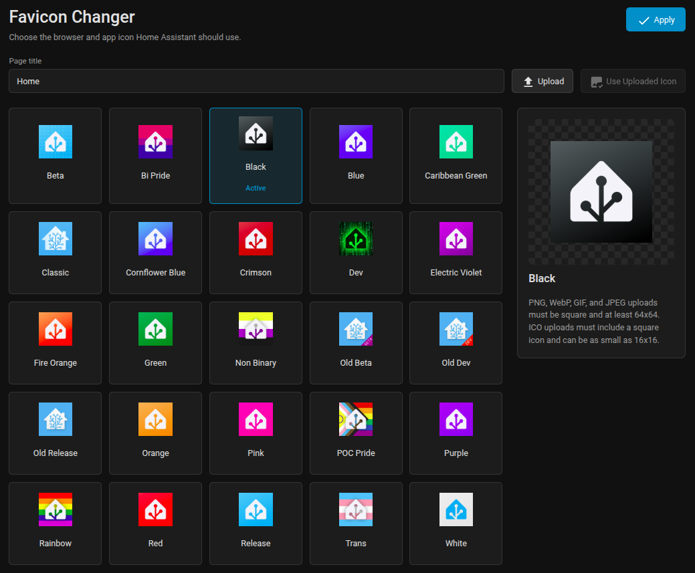

# Favicon Changer

[![HACS][badge-hacs]][link-hacs]
[![GitHub Release][badge-release]][link-release]
[![Home Assistant][badge-ha]][link-ha]
[![GitHub Commit Activity][badge-commit-activity]][link-commits]
[![HACS Validation][badge-hacs-validation]][link-hacs-validation]
[![Hassfest][badge-hassfest]][link-hassfest]
[![Tests][badge-tests]][link-tests]
[![License][badge-license]][link-license]

Change the browser title, favicon and web app icons of your Home Assistant, from built-in presets or your own icon.



## Features

- Custom page title for every Home Assistant tab
- Browser favicon, Apple touch icon and web app (PWA) icons replaced together
- Built-in presets, discovered from the `presets/` folder
- Sidebar panel to preview and apply presets or upload one custom icon

## Requirements

- Home Assistant 2026.10 or newer
- An admin user (the panel and its upload endpoint are admin-only)

## Installation

### HACS (recommended)

[![Open your Home Assistant instance and open this repository in HACS.][badge-my-hacs]][link-my-hacs]

1. Click the button above, or open **HACS → ⋮ → Custom repositories** and add
   `https://github.com/chiconws/ha-favicon-changer` with type **Integration**.
2. Search for **Favicon Changer** in HACS and click **Download**.
3. Restart Home Assistant.

### Manual

1. Download the latest [release][link-release].
2. Copy `custom_components/favicon_changer` into the `custom_components` folder of your
   Home Assistant configuration.
3. Restart Home Assistant.

## Configuration

[![Open your Home Assistant instance and start setting up Favicon Changer.][badge-my-config]][link-my-config]

1. Go to **Settings → Devices & services → Add integration**.
2. Search for **Favicon Changer** and follow the setup steps.

| Field | Description |
| --- | --- |
| Page title | Optional; replaces "Home Assistant" in the browser tab |
| Icon preset | One of the shipped presets |

Change both later from the **Favicon Changer** sidebar panel. Refresh the browser after saving.

## Favicon Panel

After setup, open `Favicon Changer` from the Home Assistant sidebar.

- Select a preset to preview it before applying.
- Upload a custom icon and preview it before applying.
- Custom uploads accept square PNG, ICO, WebP, GIF, or JPEG files up to 1 MiB.
- PNG, WebP, GIF, and JPEG uploads must be at least 64x64 and no larger than 1024x1024.
- ICO uploads must include a square icon at least 16x16.

## Troubleshooting

- **Diagnostics:** Settings → Devices & services → Favicon Changer → ⋮ →
  **Download diagnostics** (credentials are redacted). Attach the file to bug reports.
- **Debug logging:**

```yaml
logger:
  logs:
    custom_components.favicon_changer: debug
```

## Known limitations

- Browsers cache favicons aggressively; do a hard refresh if the icon does not change.
- The integration patches Home Assistant's frontend at runtime, so a frontend change in a new HA release can break it until it is updated.
- Upgrading from 2.0.x: the folder is now `custom_components/favicon_changer/`. Delete the old `ha-favicon-changer` folder, restart, delete the old entry and add Favicon Changer again; an uploaded icon is kept.

## Development

See [AGENTS.md](AGENTS.md) for the code structure. Quick checks:

```bash
uv venv --python 3.14 .venv && uv pip install -r requirements_test.txt
python -m ruff check custom_components/favicon_changer tests
python -m pytest
```

## Credits

Maintained fork of [hass-favicon](https://github.com/thomasloven/hass-favicon) by **Thomas Lovén**.

## License

MIT, see [LICENSE](LICENSE).

[badge-hacs]: https://img.shields.io/badge/HACS-Custom-41BDF5.svg
[badge-release]: https://img.shields.io/github/v/release/chiconws/ha-favicon-changer
[badge-ha]: https://img.shields.io/badge/Home%20Assistant-2026.10%2B-41BDF5?logo=home-assistant
[badge-commit-activity]: https://img.shields.io/github/commit-activity/m/chiconws/ha-favicon-changer
[badge-hacs-validation]: https://github.com/chiconws/ha-favicon-changer/actions/workflows/hacs.yaml/badge.svg
[badge-hassfest]: https://github.com/chiconws/ha-favicon-changer/actions/workflows/hassfest.yaml/badge.svg
[badge-tests]: https://github.com/chiconws/ha-favicon-changer/actions/workflows/tests.yaml/badge.svg
[badge-license]: https://img.shields.io/github/license/chiconws/ha-favicon-changer
[badge-my-hacs]: https://my.home-assistant.io/badges/hacs_repository.svg
[badge-my-config]: https://my.home-assistant.io/badges/config_flow_start.svg

[link-hacs]: https://hacs.xyz/
[link-release]: https://github.com/chiconws/ha-favicon-changer/releases/latest
[link-ha]: https://www.home-assistant.io/
[link-commits]: https://github.com/chiconws/ha-favicon-changer/commits/main
[link-hacs-validation]: https://github.com/chiconws/ha-favicon-changer/actions/workflows/hacs.yaml
[link-hassfest]: https://github.com/chiconws/ha-favicon-changer/actions/workflows/hassfest.yaml
[link-tests]: https://github.com/chiconws/ha-favicon-changer/actions/workflows/tests.yaml
[link-license]: LICENSE
[link-my-hacs]: https://my.home-assistant.io/redirect/hacs_repository/?owner=chiconws&repository=ha-favicon-changer&category=integration
[link-my-config]: https://my.home-assistant.io/redirect/config_flow_start/?domain=favicon_changer
